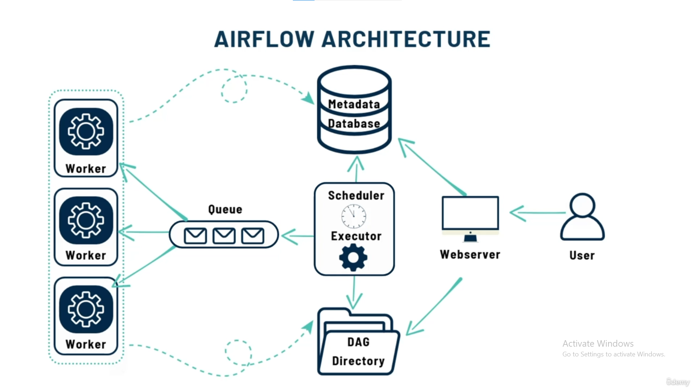

# Understanding Airflow and its architecture

## 1. What Airflow does

**Apache Airflow coordinates workflows:** it schedules tasks, respects their dependencies, tracks progress, and supports retries when configured. We describe workflows in Python as DAGs.

For YT_ELT, instead of manually executing extraction and database scripts every day, Airflow can coordinate: **fetch YouTube data → save JSON → update database tables → check data quality**. Our Python and SQL still perform the work; Airflow organizes when and in what order it happens.

This guide explains the supplied lecture and screenshot in the context of **Airflow 2.9.2**, the version used by our Dockerfile. Architecture and service names can differ in newer versions. [Airflow architecture reference](https://airflow.apache.org/docs/apache-airflow/2.9.2/core-concepts/overview.html).

## 2. What is a DAG?

A **Directed Acyclic Graph** describes tasks and their dependencies:

- **Directed:** arrows point from an upstream task to a downstream task.
- **Acyclic:** dependencies cannot loop back to an earlier task, including itself.
- **Graph:** tasks are nodes; dependency arrows connect them.

```text
Extract video statistics → Save JSON → Load staging → Update core → Quality checks
```

Each box is a task. By default, a task waits for its upstream tasks to succeed. A **DAG run** is one execution of the workflow; a **task instance** is one task in that run. Tomorrow's run creates new task instances using the same DAG definition.

A graph can also branch:

```text
                 ┌→ Check missing video IDs ─┐
Load staging ────┤                          ├→ Publish summary
                 └→ Check duplicate IDs ────┘
```

The checks can run in parallel when resources allow. Publish waits for both by default. Arrows express dependencies; they do not automatically transfer the dataset. For example, extraction may save a JSON file and pass its path to the loading task. [DAG concepts](https://airflow.apache.org/docs/apache-airflow/2.9.2/core-concepts/dags.html).

## 3. Read the architecture diagram



The diagram shows an architecture with a broker queue and separate workers, matching the course's **CeleryExecutor** setup. Not every Airflow installation needs all of these services.

| Component | Job | Example in our project |
|---|---|---|
| **DAG directory** | Holds Python workflow definitions and supporting code. | A DAG defines extraction before database loading. |
| **Scheduler** | Decides which task instances are ready, considering schedules, dependencies, and limits. | After JSON is saved successfully, loading becomes eligible. |
| **Executor** | Execution mechanism used by the scheduler; in Airflow 2.9.2 its logic runs within the scheduler process. | CeleryExecutor submits ready work to the broker. |
| **Message broker / queue** | Holds execution messages for Celery workers. The course uses Redis. | A worker picks up a message to execute an extraction task. |
| **Worker** | Executes task code. | Calls YouTube's API or runs SQL. |
| **Metadata database** | Stores workflow/task state and Airflow configuration records. | Records task status, attempts, Connections, and Variables. |
| **Webserver** | Provides the browser interface for inspecting and triggering workflows. | View runs and task logs at `http://localhost:8080` once deployed. |

The screenshot's arrows are conceptual relationships, not a complete network or storage specification. In Airflow 2.9.2, the webserver uses serialized DAG definitions from the metadata database; it does not need to parse source DAG files for normal UI display.

### What actually happens when a task runs?

```text
Schedule becomes due, or user triggers a DAG run
                      ↓
Scheduler identifies a ready task
                      ↓
CeleryExecutor → Redis message → Worker executes task code
                      ↓
Task state is tracked in the metadata database
                      ↓
Scheduler releases eligible downstream tasks; UI shows progress
```

Redis carries execution messages, rather than being our warehouse for YouTube data. One worker can execute multiple tasks concurrently, depending on its configuration; the diagram's three workers illustrate scaling, not a requirement to create three.

## 4. Metadata database versus project data and logs

The narration overstates what the metadata database stores. Keep these locations distinct:

| Information | Where it belongs |
|---|---|
| DAG source code | Python files in the DAG directory; serialized DAG representations are also stored in metadata. |
| Run/task status, scheduling records, Variables, Connections | Airflow metadata database, typically PostgreSQL in this course. |
| Detailed task log output | Normally log files; remote logging can use services such as S3. |
| Extracted YouTube JSON and business tables | Project data files and the ELT database, separately from Airflow's operational metadata. |

Airflow can display task logs in the UI without storing all their text in its metadata database. [Task logging reference](https://airflow.apache.org/docs/apache-airflow/2.9.2/administration-and-deployment/logging-monitoring/logging-tasks.html).

PostgreSQL can host several databases on one server: an Airflow metadata database and our YouTube database can share a PostgreSQL service while having different purposes. Airflow 2.9.2 also supports MySQL; SQLite is appropriate only for limited development/testing setups.

## 5. Which executor, and why?

The transcript drops some names. Its intended comparison is:

| Executor | How tasks execute | Typical fit |
|---|---|---|
| **SequentialExecutor** | One task at a time. | Basic development/testing. |
| **LocalExecutor** | Parallel processes on the scheduler's machine. | A single-machine deployment, including suitably sized production workloads. |
| **CeleryExecutor** | Tasks distributed through a broker to workers. | Our course; expandable to multiple workers/machines. |
| **KubernetesExecutor** | Tasks execute in Kubernetes pods. | Environments already using Kubernetes. |

The lecture's missing executor name is **CeleryExecutor**, confirmed by the downloaded course Compose file. That is the Compose configuration's choice, not a universal default for all Airflow installations. LocalExecutor is not restricted to testing, and Kubernetes is not required for production. [Airflow 2.9.2 executors](https://airflow.apache.org/docs/apache-airflow/2.9.2/core-concepts/executor/index.html).

## 6. Triggerer and waiting tasks

The transcript's “airflow trigger” means **triggerer**, and “variable operators” means **deferrable operators**.

For example, a deferrable sensor can wait for an S3 file without keeping a worker slot occupied:

```text
Task waits for file → Defers and frees its worker slot
                   → Triggerer monitors the condition
                   → Event fires → Scheduler queues task to resume on a worker
```

The triggerer handles the waiting trigger; the resumed task still executes on a worker. A normal sensor is not automatically deferrable. The course plans to omit the triggerer because its workflow does not use deferrable operators. Triggering another DAG with `TriggerDagRunOperator` does not itself require this service. [Deferrable operators and triggers](https://airflow.apache.org/docs/apache-airflow/2.9.2/authoring-and-scheduling/deferring.html).

## 7. How the downloaded course organizes YT_ELT

The reference `dags/main.py` defines **three DAGs**, rather than one large DAG:

```text
produce_json
  Playlist ID → Video IDs → Extract statistics → Save JSON → Trigger update_db

update_db
  Load/update staging → Update core tables → Trigger data_quality

data_quality
  Check staging → Check core
```

`produce_json` has a daily schedule; the other two have `schedule=None` and are triggered by the preceding workflow. In this reference, the quality checks are sequential, unlike the illustrative parallel example above. Triggering a downstream DAG does not automatically mean waiting for it to finish; that requires explicit configuration.

These are reference-course workflows, not DAGs we have already installed in our working project. See the [downloaded DAG source](../../../../Course%20Downloads/Code/YT_ELT-main/dags/main.py).

**Where Podman fits:** it runs the containers hosting these Airflow services, Redis, and PostgreSQL. The image we built supplies Airflow and its Python dependencies; the later Compose file will connect the services, folders, and settings. Building or publishing that image alone does not start this architecture.
