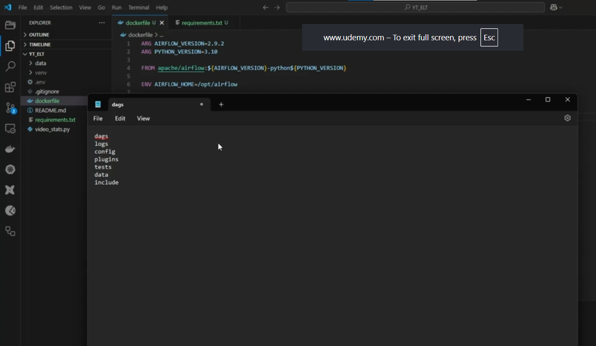

# Understanding Airflow directories and container mounts

## 1. Overview — files on our laptop, used by Airflow

Airflow needs workflow code, supporting resources, and somewhere to write logs. Our project keeps these in separate folders so we can edit and inspect them easily in VS Code.

Later, Compose will **mount these Windows project folders into the Airflow containers**. Airflow will see Linux paths such as `/opt/airflow/dags`, while we work with `YT_ELT\dags` on Windows. Podman runs the containers through our WSL2 machine.

The transcript's “dark code” means **DAG code**. Its “Docker volumes” wording describes what are more precisely **bind mounts**: existing project folders exposed inside containers.



## 2. Our project layout

These folders belong in the **YT_ELT project root**, beside `Dockerfile`, not inside `Markdowns`:

```text
YT_ELT/
├── dags/          Workflow definitions and supporting Python modules
├── logs/          Generated Airflow execution logs
├── config/        Optional custom Airflow configuration resources
├── plugins/       Optional Airflow extensions
├── tests/         Automated tests for our project
├── data/          Existing extracted JSON files
├── include/       Resources used by tasks, such as quality-check YAML
├── Dockerfile
├── requirements.txt
├── .env
└── Markdowns/     Learning guides and screenshots
```

`data` already existed and has been preserved. The other six folders have now been created, including optional `config` and `plugins` for consistency with the lecture. Empty folders contain `.gitkeep`: a placeholder that lets Git track them; Airflow does not require this file. Generated files under `logs` are ignored by Git.

## 3. What each directory does

| Folder | Purpose and example | How Airflow uses it |
|---|---|---|
| **`dags`** | Defines workflows, for example `youtube_pipeline.py` declaring extraction before loading. Supporting modules can be organized in subfolders. | DAG processing discovers Python DAG definitions; the scheduler schedules their tasks and workers need the task code. |
| **`logs`** | Records execution details: API errors, retry messages, SQL failures, and task output. | Airflow's configured logging writes files that can be viewed through the UI. The standard setup includes task and scheduler logs. |
| **`config`** | Optional settings resources, such as `airflow_local_settings.py` for logging or cluster policies. | Used when configured appropriately; putting an arbitrary file here does not activate a setting. We do not need custom content yet. |
| **`plugins`** | Optional registered extensions, such as custom UI features or reusable Airflow integrations. | Airflow loads supported plugins. An ordinary helper function or custom operator can also live in an importable Python module; not every helper must be a plugin. |
| **`tests`** | Checks code behavior, DAG structure, and pipeline integration; for example, test that saved JSON has required fields. | A test runner such as pytest or CI executes these tests. Airflow does not automatically run this folder. |
| **`data`** | Stores extracted business data, such as a dated YouTube statistics JSON file. | One task writes a file and another reads it, provided both see the same mounted location. It is not the Airflow metadata database. |
| **`include`** | Holds task resources: quality-check YAML, SQL scripts, certificates, or JARs. The course uses Soda YAML files. | Task code explicitly opens these resources. Airflow does not automatically execute everything in this directory. |

`dags`, `logs`, `config`, and `plugins` are common Airflow deployment directories. `tests`, `data`, and `include` are project organization conventions, rather than mandatory Airflow core directories. See the [Airflow 2.9.2 directory guidance](https://airflow.apache.org/docs/apache-airflow/2.9.2/howto/docker-compose/index.html).

## 4. How local folders become container paths

A later Compose service definition can contain this mapping:

```yaml
# Example fragment inside an Airflow service; not a complete Compose file.
volumes:
  - ./dags:/opt/airflow/dags
  - ./logs:/opt/airflow/logs
  - ./config:/opt/airflow/config
  - ./plugins:/opt/airflow/plugins
  - ./tests:/opt/airflow/tests
  - ./data:/opt/airflow/data
  - ./include:/opt/airflow/include
```

**Left of the colon:** the project folder, relative to the Compose file's base directory. **Right:** the Linux path inside that container. Apply the required mappings to each relevant Airflow service, especially workers that execute the code.

```text
Edit on Windows                      Visible inside Airflow container
YT_ELT/dags/youtube_pipeline.py  →    /opt/airflow/dags/youtube_pipeline.py
YT_ELT/include/soda/checks.yml   →    /opt/airflow/include/soda/checks.yml
YT_ELT/data/videos.json         ↔    /opt/airflow/data/videos.json
YT_ELT/logs/...                 ←    /opt/airflow/logs/...
```

Mounts expose the same underlying files; they are not independent copies. By default, writes can go both ways. Editing a mounted DAG changes what the container sees without rebuilding the image, but Airflow still needs time to reparse it; running tasks do not automatically restart. Configuration/plugin changes may require service restarts.

Creating folders alone does **not** create these mounts. We have not yet added or started the project's Compose setup. With Windows/WSL2, we will verify that the mounted host paths are accessible and writable when we reach that stage. [Bind mounts explained](https://docs.docker.com/engine/storage/bind-mounts/).

## 5. Example — one YouTube pipeline across these folders

Suppose `dags/youtube_pipeline.py` defines three tasks:

```text
Extract YouTube statistics → Load database tables → Run quality checks
         ↓                          ↓                      ↑
data/videos.json             Business database     include/soda/checks.yml

All tasks produce execution logs → logs/
tests/ checks the code and workflow before deployment
```

1. The scheduler reads the DAG definition and submits ready tasks for execution.
2. A worker runs extraction and writes `/opt/airflow/data/videos.json`. We can inspect the same file in the Windows `data` folder.
3. The loading task reads that shared file and inserts records into the project's database.
4. The quality task reads YAML rules from `/opt/airflow/include/soda/checks.yml`, for example checking for duplicate video IDs.
5. Logs explain what each task did. Airflow's metadata database separately records statuses such as success, failure, and retry.

These filenames are examples, not new runnable tasks. Task code should use container paths or a configured project base path; a Windows `F:\...` path will not directly work inside a Linux container. A relative path such as `data/videos.json` depends on the process's working directory, so it should not be assumed to resolve correctly everywhere.

## 6. Mounts, images, and persistent storage

| Mechanism | When it applies | Example |
|---|---|---|
| **Dockerfile `COPY`** | Build time; files become part of the image. Changes require rebuilding. | Our image copies `requirements.txt` and installs packages. |
| **Project bind mount** | Container runtime; exposes an existing project folder. | DAG edits and generated JSON are shared with the host. |
| **Named volume** | Container runtime; engine-managed persistent storage. | PostgreSQL database files. This differs from our Windows project `data` folder. |

Our `.dockerignore` excludes `data` and `logs` from image builds, but does **not** prevent mounting them at runtime. A Docker Hub push uploads image contents; it does not upload bind-mounted project folders or database volumes.

For this lecture, the folders are ready. The following lessons will supply the DAGs, resources, settings, and Compose mappings that make them work together. Existing root-level Python scripts have been left in place.
