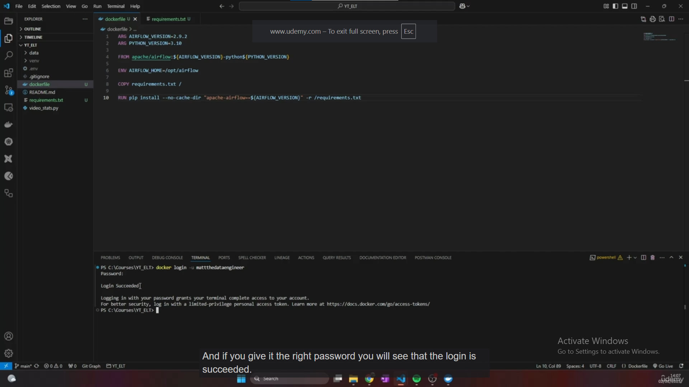
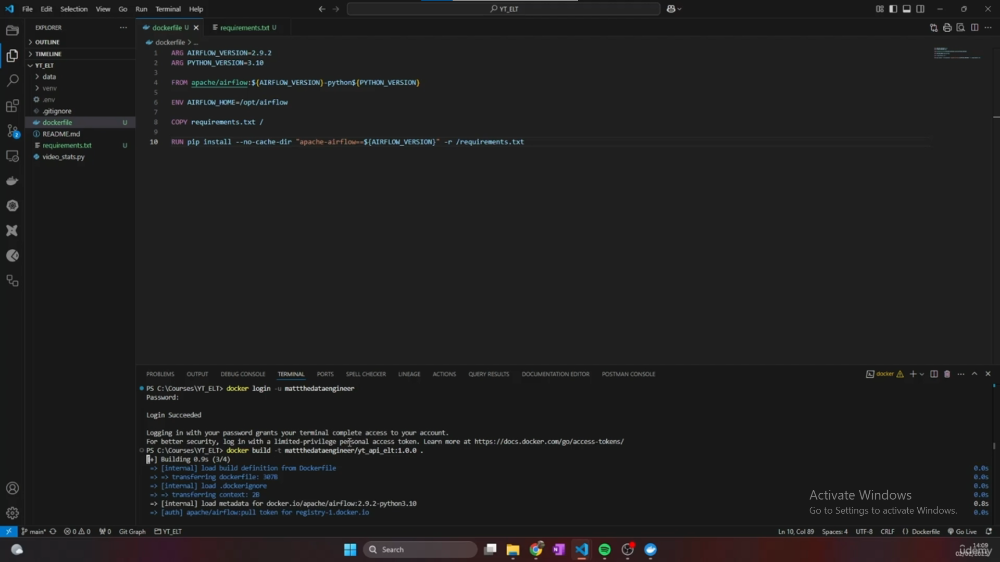
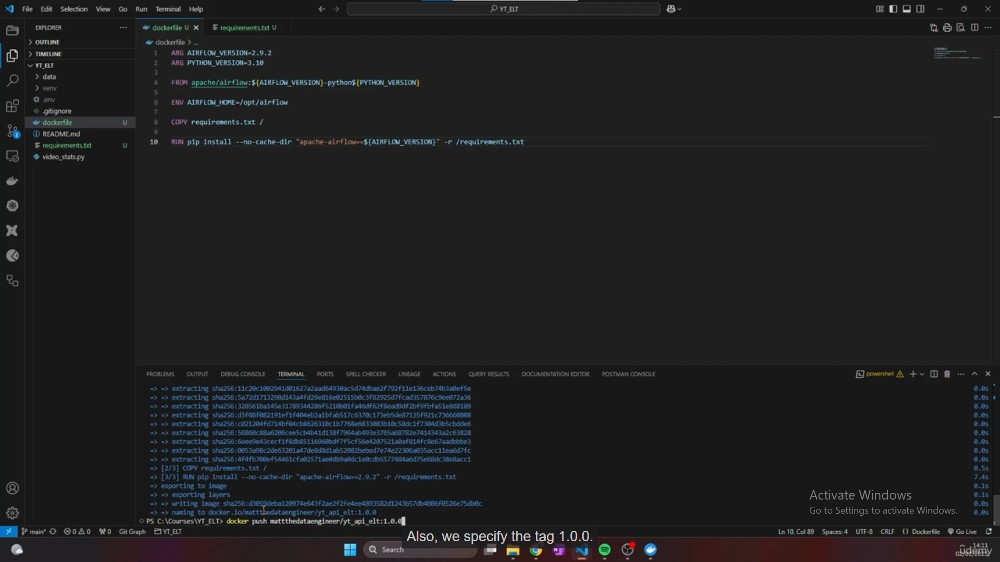
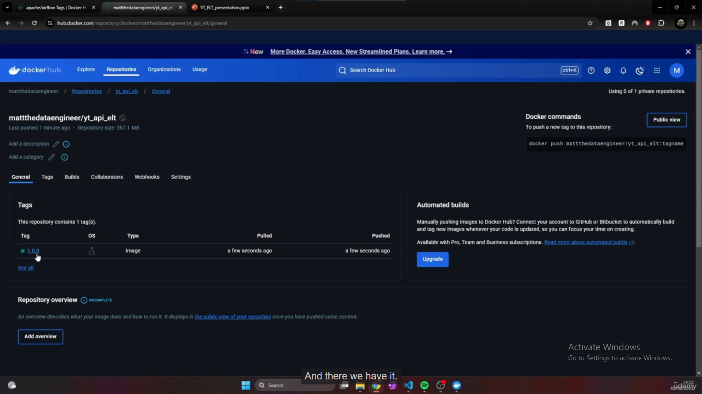

# Building an image and storing it on Docker Hub

The previous lecture wrote the **recipe** (`Dockerfile`). This lecture turns that recipe into an **image on your computer**, then uploads the image to **Docker Hub** so it can be downloaded later. It does not start the full Airflow environment yet.

This explanation follows your supplied transcript and four screenshots. Docker commands explain the instructor's actions; the final section translates them to our Podman setup.

## 1. The whole process

```text
Dockerfile + requirements.txt in YT_ELT
                  ↓ build
Custom Airflow image in the local engine's image storage
                  ↓ push
Docker Hub repository, tagged 1.0.0
                  ↓ pull later
Image available to another machine or deployment
```

| Term | Meaning in this lecture |
|---|---|
| Registry | A service storing and distributing container images; we use Docker Hub. |
| Repository | A named image collection inside a registry, such as `matthedataengineer/yt_api_elt`. |
| Namespace | The user or organization owning that repository, here `matthedataengineer`. |
| Tag | A label selecting an image version, here `1.0.0`. |
| Build | Read the Dockerfile and assemble an image locally. |
| Push / pull | Upload an image to / download an image from a registry. |

**GitHub and Docker Hub have different jobs:** Git stores versioned source files; Docker Hub stores built container images. A Git commit does not upload the image, and an image push does not commit your project code.

## 2. Create the destination repository

**Where:** a browser at [Docker Hub](https://hub.docker.com/).

Sign in, open **Repositories**, and create a repository under your own account. Use a meaningful name such as `yt_api_elt`. The transcript's spoken/transcribed name is inconsistent; the screenshots show **`yt_api_elt`**.

The instructor selects **Public**. That means other people can download the published image. A private repository limits access; either choice serves the same build/push concept. Choose visibility deliberately for your project.

Creating the repository creates the **destination**, not the image. Its namespace and repository name must match what you use in the commands.

## 3. Login — give the terminal permission to upload



**Where:** the terminal in VS Code, or another PowerShell terminal. Login works from any directory.

The instructor runs:

```powershell
docker login -u matthedataengineer
```

`-u` supplies the Docker Hub username. Entering a valid credential at the password prompt produces **`Login Succeeded`**. Signing into the website alone does not necessarily authenticate this command-line tool.

For your own login, prefer a **personal access token (PAT)** with permission to push, entered at the password prompt. The screenshot itself recommends a limited-privilege token. Docker requires a PAT for CLI login when two-factor authentication is enabled. Keep the token in a password manager, rather than the Dockerfile, Git, or a command containing a literal password. [Docker access-token guidance](https://docs.docker.com/security/access-tokens/).

Login does not build, upload, or run anything. A public base image can often be pulled without login; authenticated access is needed to push into your account's repository.

## 4. Build — execute the recipe locally



**Where:** the project root containing `Dockerfile` and `requirements.txt`. The instructor's terminal shows `C:\Courses\YT_ELT`; use your own YT_ELT folder instead.

```powershell
docker build -t matthedataengineer/yt_api_elt:1.0.0 .
```

Read it as: “Build from this folder and name the result as version 1.0.0 of my repository.”

| Part | Purpose |
|---|---|
| `docker build` | Build an image using the Dockerfile. |
| `-t` | Give the result an image name and tag. |
| `matthedataengineer` | Instructor's namespace; replace it with yours. |
| `yt_api_elt` | Repository name created on Docker Hub. |
| `:1.0.0` | Custom image version label, independent of Airflow's version. |
| Final `.` | Current directory is the build context, supplying files for instructions such as `COPY`. |

The engine obtains the Airflow/Python base image if necessary, copies `requirements.txt`, executes the pip command, and saves the resulting image locally. The first build can take time because the base image is large; later builds may reuse cached layers.

The name describes its intended registry location, but **building does not upload it**. Also, a tag is a label, not an immutable identifier: pushing a different image under `1.0.0` can replace what that tag points to. Use a new tag such as `1.0.1` for a deliberate next revision.

## 5. Push — upload the built image



The screenshot shows the `COPY` and `RUN pip install` steps completing, followed by image export and naming. The instructor then runs:

```powershell
docker push matthedataengineer/yt_api_elt:1.0.0
```

The image name and tag must identify the image just built. Push transfers its layers to Docker Hub; layers already present may be reused. A successful push publishes the tag in the repository. It does not start an Airflow container.

Only files incorporated into the image are published, not automatically your entire workspace. Our current Dockerfile copies the requirements list; it does not yet copy the Python scripts or DAGs. Our `.dockerignore` also excludes `.env`, the Windows `venv`, data, and documentation from the build context.

## 6. Verify in Docker Hub



**Where:** refresh your repository page and inspect its **Tags** list. The instructor's page shows **`1.0.0`**, proving the image was uploaded to his repository. Your image should appear under your own namespace.

A future machine can download a published image with `docker pull USERNAME/yt_api_elt:1.0.0`. That avoids rebuilding from the recipe each time. Starting the Airflow services still needs the later configuration and Compose work.

## 7. The same workflow using our Podman setup

Docker Hub works with Podman too. Keep the Dockerfile and requirements; replace the engine commands and explicitly name the registry. Compose and Astro are not needed for this build/push exercise.

**Where:** Windows PowerShell in your YT_ELT project root. First check `podman machine list`; if `astro-machine` is stopped, run `podman machine start astro-machine`.

Replace the example username below with your real Docker Hub username, and create `yt_api_elt` in that account before pushing:

```powershell
# Set this once in the current PowerShell session.
$hubUser = "YOUR_DOCKER_HUB_USERNAME"
$imageRef = "docker.io/${hubUser}/yt_api_elt:1.0.0"

# Paste your access token at the password prompt.
podman login -u $hubUser docker.io

# Build from the current project directory and test Airflow's version.
podman build -f Dockerfile -t $imageRef .
podman run --rm $imageRef airflow version

# After the build and version check succeed, publish to your repository.
podman push $imageRef
```

Expect Airflow **2.9.2** from the test, then verify tag **1.0.0** on Docker Hub after the push. Podman's terminal output will look different from the instructor's Docker output; the stages mean the same thing. [Podman login](https://docs.podman.io/en/stable/markdown/podman-login.1.html), [Podman push](https://docs.podman.io/en/stable/markdown/podman-push.1.html).

If you already built `localhost/yt-elt-airflow:lecture` using our earlier guide, you can assign the registry name to that existing image instead of rebuilding:

```powershell
podman tag localhost/yt-elt-airflow:lecture $imageRef
podman push $imageRef
```

Tagging adds another reference to the existing image; it does not alter its contents. Common failures are wrong credentials, a namespace you cannot push to, a mismatched local tag, or running the build outside the project root. Fix the failing stage before moving to the next.

**Lecture outcome:** a custom image exists locally and is published under a versioned Docker Hub tag. This guide documents the steps; no account login, image build, or upload was performed while writing it.
