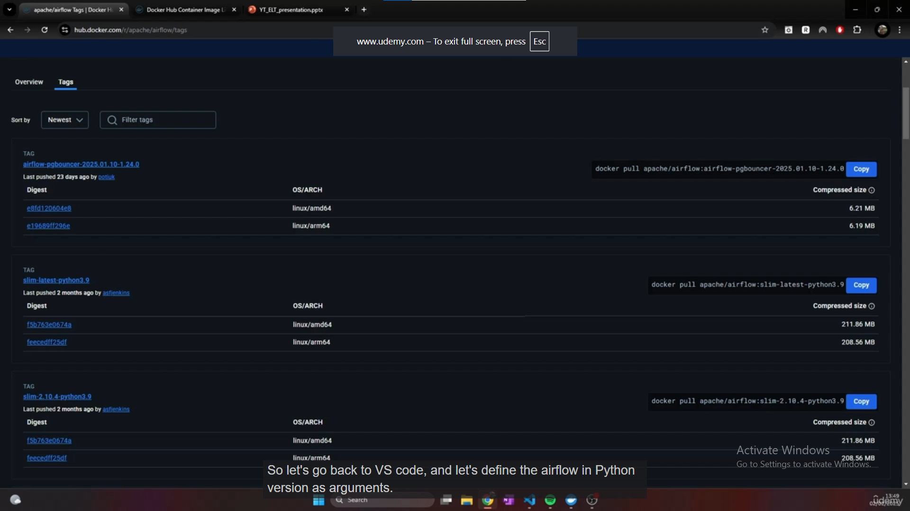
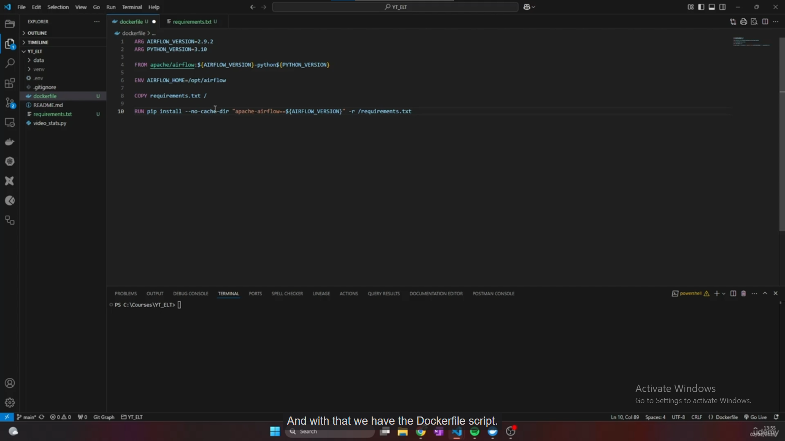

# Understanding the Dockerfile lecture

The lecture prepares a **recipe for an Airflow environment**: start with an existing image containing Airflow and Python, then add the Python packages our project needs. Writing this recipe does not build the image or start Airflow yet; building comes in the next lecture.

Based on your supplied [lecture transcript](https://www.udemy.com/course/start-your-data-engineering-journey-project-based-learning/learn/lecture/52042755#notes), screenshots, and the downloaded course `dockerfile`.

## 1. What are we making, and why?

Your YouTube scripts extract data. Later, Airflow will schedule and coordinate tasks such as extraction, loading, and data-quality checks. The environment executing those tasks needs the right Python version and packages.

Think of a Dockerfile as a recipe, an image as the prepared application environment, and a container as an instance using that environment to execute processes.

```text
Existing Airflow image + requirements.txt + Dockerfile instructions
                              ↓ build
                     Our custom Airflow image
                              ↓ run
                    Airflow service containers
```

Your Windows `venv` serves local Python development. Installing a package there does **not** install it inside a container. The image needs its own dependencies; it can also use Python 3.10 independently of your Windows Python version.

## 2. Understanding the Docker Hub screen



Docker Hub stores images. `apache/airflow` identifies the Airflow image repository, while the text after `:` selects a **tag**, a label identifying a particular version or variant.

The lecture selects:

```text
apache/airflow:2.9.2-python3.10
└ repository ┘ └──── tag ────┘
```

This means “use the Airflow image with Airflow 2.9.2 and Python 3.10.” You inherit the software and configuration already packaged in that image.

The screenshot also shows `slim` tags: smaller variants with fewer preinstalled dependencies. The course's chosen tag does not include `slim`. The `linux/amd64` and `linux/arm64` rows describe Linux images for different processor architectures; they are not Windows versions.


The first two supplied screenshots show the same view. The transcript briefly says **2.9.0**, but the completed code and downloaded course file both specify **2.9.2**. Use 2.9.2 when following this example; “recent” in the narration refers to the recording date.

## 3. The complete recipe



The code shown is:

```dockerfile
ARG AIRFLOW_VERSION=2.9.2
ARG PYTHON_VERSION=3.10

FROM apache/airflow:${AIRFLOW_VERSION}-python${PYTHON_VERSION}

ENV AIRFLOW_HOME=/opt/airflow

COPY requirements.txt /

RUN pip install --no-cache-dir "apache-airflow==${AIRFLOW_VERSION}" -r /requirements.txt
```

Save such a recipe as `Dockerfile` without a `.txt` extension. The instructor uses lowercase `dockerfile`; an explicit `-f dockerfile` can select that filename when building.

### ARG — Choose the versions

```dockerfile
ARG AIRFLOW_VERSION=2.9.2
ARG PYTHON_VERSION=3.10
```

These provide build-time settings. `${NAME}` inserts a setting's value, so the next line can construct the image name without repeating the version numbers.

### FROM — Start with an existing environment

```dockerfile
FROM apache/airflow:${AIRFLOW_VERSION}-python${PYTHON_VERSION}
```

With those defaults, this selects `apache/airflow:2.9.2-python3.10`. We are extending an image that already has Airflow and Python installed.

**Small scope detail:** an `ARG` declared before `FROM` is not automatically available to later `RUN` instructions. The Airflow base image supplies its own `AIRFLOW_VERSION` environment variable, which explains its use in the final command. When you need a pre-`FROM` build argument inside the build stage, redeclare it there, for example `ARG AIRFLOW_VERSION`. See the [Dockerfile reference](https://docs.docker.com/reference/dockerfile/#understand-how-arg-and-from-interact).

### ENV — Tell Airflow where its home is

```dockerfile
ENV AIRFLOW_HOME=/opt/airflow
```

This sets an environment variable retained in the image for containers to use. `/opt/airflow` is a **Linux path inside the container environment**, not a folder on your Windows `C:` drive.

Airflow uses this location for its configuration and default folders such as `dags` and `logs`. This line states the usual home location; it does not copy your scripts, create a Windows folder, or start Airflow.

### COPY — Put the package list inside the image

```dockerfile
COPY requirements.txt /
```

The source is the local `requirements.txt` in the **build context**, the directory made available to the builder. The destination `/` means the image filesystem's root directory, producing `/requirements.txt`.

For the lecture's layout, keep `Dockerfile` and `requirements.txt` beside each other in the project root. The file may be empty now, but it must exist for `COPY` to succeed. Copying it does not install anything yet.

### RUN — Install the listed packages during the build

```dockerfile
RUN pip install --no-cache-dir "apache-airflow==${AIRFLOW_VERSION}" -r /requirements.txt
```

| Part | Meaning |
|---|---|
| `RUN` | Execute this command while building the image. |
| `pip install` | Install Python packages into the image's Python environment. |
| `--no-cache-dir` | Avoid keeping pip's download cache, helping keep the image smaller. |
| `"apache-airflow==${AIRFLOW_VERSION}"` | Require the existing Airflow version, here 2.9.2. |
| `-r /requirements.txt` | Read additional package requirements from the copied file. |

Why mention Airflow again? A new package could otherwise cause pip to change Airflow's version while resolving dependencies. Explicitly requiring the same version makes incompatible requirements produce an error instead of silently changing Airflow. It does not necessarily reinstall an already satisfied package. This follows [Airflow's image-extension guidance](https://airflow.apache.org/docs/docker-stack/build.html#adding-packages-from-requirements-txt).

The transcript's “no cash” means **no cache**. This option concerns pip's cache; it does not disable Docker/Podman's build-layer cache.

## 4. A concrete example for this project

Suppose a task imports `requests`, and the selected image does not already provide the version you need. A requirements file could contain:

```text
# Illustrative entry; use a version tested with the project
requests
```

Building reads that list and installs the package into the custom image. Containers created from it can then import `requests`. Changing the list later requires rebuilding the image and using the updated image for your containers. The lecture mentions Soda for future data-quality checks; it does not yet specify its package name or version.

This Dockerfile copies **only the requirements file**. Your scripts, DAGs, database connections, credentials, and service startup configuration still need to be supplied in later steps.

## 5. How this fits your Podman setup

Our previously recorded approach is Podman using a WSL2 Linux machine. Podman can build this same Dockerfile; the word “Dockerfile” does not require Docker Desktop. See [Podman's build documentation](https://docs.podman.io/en/stable/markdown/podman-build.1.html).

For context only, after preparing the two files in the project root and starting your Podman machine:

```powershell
podman build -f Dockerfile -t yt-elt-airflow:lecture .
```

Here `-f` selects the recipe, `-t` names the resulting image, and `.` supplies the current directory as the build context. A Docker-based tutorial would use `docker build` for the equivalent step. Building does not start the Airflow services; their orchestration comes later. Astro is another management layer from your earlier setup, not an instruction in this Dockerfile.

**What you should understand at the end of this lecture:** we have described how to extend a ready-made Airflow/Python image with project dependencies. The image still needs to be built, and containers still need to be configured and started.
