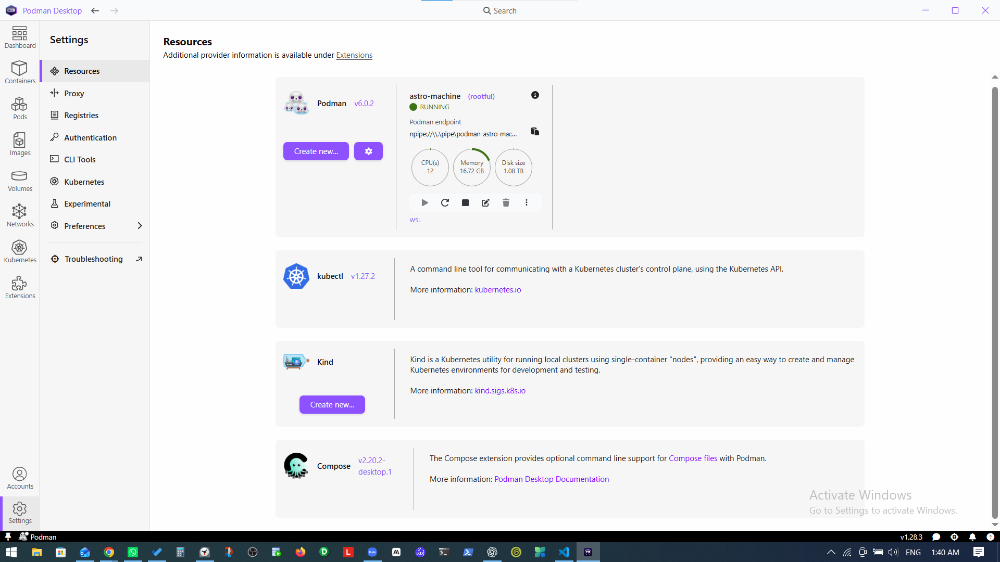
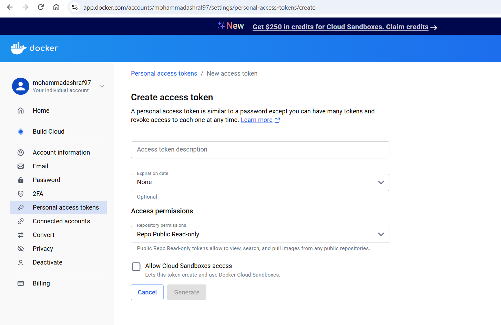
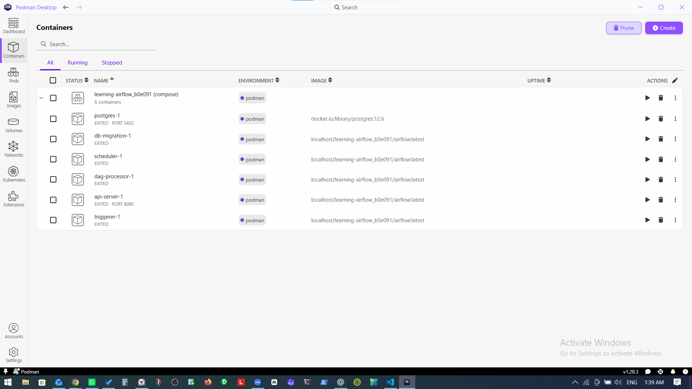
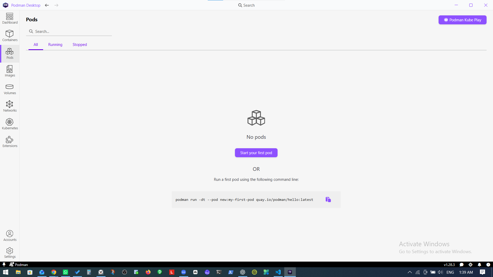
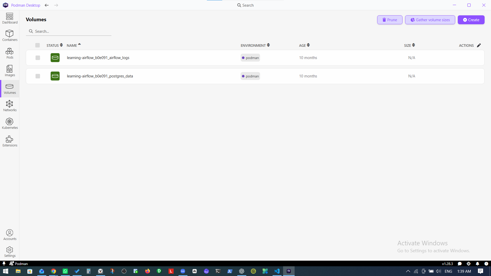

# Build and publish our Airflow image with Podman

## 1. Overview

This guide reproduces the previous lecture's outcome using **Podman on Windows**: log in to Docker Hub, build our Airflow image, assign version `1.0.0`, and push it to our repository. Use PowerShell for commands and Podman Desktop to inspect the engine and images. Desktop alternatives are included where useful; performing an action in one interface does not require repeating it in the other.

```text
YT_ELT/Dockerfile + requirements.txt
                  ↓ Podman build, inside the WSL2 machine
Local image: docker.io/YOUR_USERNAME/yt_api_elt:1.0.0
                  ↓ Podman push
Docker Hub: YOUR_USERNAME/yt_api_elt, tag 1.0.0
```

**Podman is the engine; Docker Hub is the online image registry.** Using Docker Hub does not require Docker Desktop. Our existing `astro-machine` supplies Linux through WSL2. We do not need Astro CLI, Compose, pods, or a running Airflow application for this exercise.

These are instructions for you to execute. Creating this guide has not built or uploaded an image.

## 2. Check the machine in PowerShell and Desktop

**Where:** Windows PowerShell, either standalone or VS Code's terminal. These checks work from any folder:

```powershell
podman machine list
podman version
```

If `astro-machine` is stopped, run `podman machine start astro-machine`, then repeat `podman version`. Expect both client and server sections. Our earlier output showed client 6.0.2 and server 5.7.1 responding successfully.

**Desktop:** open **Settings → Resources**. Your screenshot shows `astro-machine (rootful)` as **RUNNING**, with the WSL provider. Reuse that machine and mode.



The screenshot's 16.72 GB memory is consistent with the engine's earlier reported memory, despite the old 2 GiB value in the machine listing. No resource change is required for these checks. The Compose tile is unrelated to building and publishing this image.

## 3. Prepare the Docker Hub destination

**Where:** a browser at [Docker Hub](https://hub.docker.com/).

1. Sign in to your account.
2. Open **Repositories** and create a repository named `yt_api_elt` under your own namespace.
3. Choose visibility: public allows others to download the image; private restricts access.
4. Generate a personal access token using the steps below, then use it for Podman's login.

For example, a hypothetical user `ashrafdemo` would publish `docker.io/ashrafdemo/yt_api_elt:1.0.0`. Use your actual Docker Hub username, not that example or the instructor's account.

### Generate the access token

**Where:** your browser, signed in to [Docker Home](https://app.docker.com/). Open your account menu → **Account settings → Personal access tokens → Generate new token**. This opens the form in your screenshot.



A token is a separate credential used in place of your account password. It lets Podman authenticate to Docker Hub, even though the container engine is not Docker.

| Field in your screenshot | What to enter or select |
|---|---|
| **Access token description** | `YT_ELT Podman laptop` — a required name so you recognize its purpose later. |
| **Expiration date** | For example, **90 days**, if that covers your course work. `None` means no expiration; an expired token needs replacing. |
| **Repository permissions** | **Repo Read & Write**, allowing both pull and push. Delete permission is unnecessary for this exercise. |
| **Allow Cloud Sandboxes access** | Leave unchecked; our builds run locally in Podman, not Docker Cloud Sandboxes. |

**Change the screenshot's default `Repo Public Read-only`: it permits public-image pulls but cannot upload your image.** Login can succeed with that permission while a later push is denied. Repository permissions apply across repositories your account can access, rather than being restricted by the description you entered. [Docker permission reference](https://docs.docker.com/security/access-tokens/reference/).

Select **Generate** after completing the form. Copy the resulting token into a password manager immediately; Docker displays its value only once. If you leave without saving it, generate a replacement. Do not add the token to this Markdown file, `.env`, the Dockerfile, or Git. If the button remains disabled, check the required description is filled in; Docker also requires a verified email address before token creation. [Official token-generation steps](https://docs.docker.com/security/access-tokens/personal-access-tokens/).

In step 5, enter your **Docker Hub username** as the username and paste this **token** when Podman asks for a password. For the account shown in your screenshot, the username is `mohammadashraf97`; you can use that value for `$hubUser` below. The same username/token pair works in Podman Desktop's registry login.

## 4. Enter the project and set the image name

**Where:** PowerShell. Change into our project root:

```powershell
Set-Location "F:\Data Engineering\Training\Data Engineering Automation\Data Engineering Project SQL, Python, Airflow, Docker, CICD - Udemy\Project Directory\YT_ELT"
Get-Item Dockerfile, requirements.txt, .dockerignore
```

All three files should exist. `requirements.txt` currently contains comments only, which is valid. `.dockerignore` excludes local credentials, Windows Python environments, and other unnecessary build inputs.

Set the following variables once in the current terminal, replacing the placeholder:

```powershell
$hubUser = "YOUR_DOCKER_HUB_USERNAME"
$imageRef = "docker.io/${hubUser}/yt_api_elt:1.0.0"
$imageRef
```

Check the printed name before continuing. `docker.io` selects Docker Hub; `$hubUser` selects the owner; `yt_api_elt` is the repository; `1.0.0` is our image version. It is separate from Airflow version 2.9.2. Opening a new PowerShell session requires setting these variables again.

## 5. Log in with Podman

**PowerShell:**

```powershell
podman login -u $hubUser docker.io
```

Paste your token at the password prompt. It will normally remain invisible while entered. Expect **Login Succeeded**. Do not place the token in project files or directly in the command.

**Desktop alternative:** open **Settings → Registries**, find **Docker Hub**, select **Configure**, enter your username and token, and select **Login**. This configures Podman's registry authentication. If either interface later reports unauthorized access, verify the account and authenticate through the interface being used. [Registry setup](https://podman-desktop.io/docs/containers/registries).

Website login, registry authentication, and machine startup are separate: the first opens your account page, the second permits registry operations, and the third runs the local engine.

## 6. Build the image

**PowerShell, still in YT_ELT:**

```powershell
podman build -f Dockerfile -t $imageRef .
```

| Part | Meaning |
|---|---|
| `-f Dockerfile` | Read our image recipe. |
| `-t $imageRef` | Name and tag the output for the destination repository. |
| Final `.` | Use the current directory as the build context. |

Podman obtains the base Airflow/Python image, copies the requirements list, executes the package-install command, and stores the result locally. Downloads can make the first build slow. Stop here if the build fails; pushing requires a successful image build.

**Desktop alternative:** select **Images → Build**. Choose the project's `Dockerfile`, set **Build context directory** to the YT_ELT root, and enter the complete image name printed in step 4. Keep the Dockerfile's version defaults and use the normal x86_64 platform for this laptop. Select **Build**, then **Done** on success. Desktop labels may vary slightly by version. [Desktop build instructions](https://podman-desktop.io/docs/containers/images/building-an-image).

The image name containing `docker.io` does **not** upload anything during the build. Publishing is a separate step.

## 7. Verify locally and understand the Desktop pages

**PowerShell:**

```powershell
podman image inspect $imageRef --format '{{.Id}}'
podman run --rm $imageRef airflow version
```

Expect an image ID followed by **2.9.2** from the second command. The test runs one temporary container and removes it on exit; it does not start the Airflow web interface.

**Desktop:** select **Images** and search for `yt_api_elt`. Confirm the repository/tag, then open the image to inspect its details. This is where the newly built artifact should appear.



Your **Containers** screenshot shows the older `learning-airflow_b0e091` application, not this new image. Keep those containers stopped; building an image does not add a permanent running container here.



The empty **Pods** page is normal. A pod groups containers; creating one is not part of this lecture.



The **Volumes** page shows old application storage. These volumes are not uploaded with our image, and no new volume is required for this build/push exercise. Keep them intact; pruning is not a preparation step.

## 8. Push the image and verify the published tag

**PowerShell, after the build and local check succeed:**

```powershell
podman push $imageRef
```

This uploads the image to the repository created in step 3. Layers already present may be reused. Wait for successful completion; an upload in progress is not proof of publication.

**Desktop alternative:** with registry authentication configured, go to **Images**, find the fully qualified image, open its **⋮** menu, select **Push Image**, confirm the `1.0.0` tag, and select **Push image**. Finish with **Done**. [Desktop push instructions](https://podman-desktop.io/docs/containers/images/pushing-an-image-to-a-registry).

**Browser:** refresh your Docker Hub repository's **Tags** view. Seeing **1.0.0** under your namespace confirms the publication. Optionally, `podman pull $imageRef` checks that Podman can resolve and retrieve the published tag; cached layers may make this fast.

If you already built `localhost/yt-elt-airflow:lecture` from the earlier guide, you may replace step 6 with the following, then continue with verification and push:

```powershell
podman tag localhost/yt-elt-airflow:lecture $imageRef
```

This adds a repository reference to the existing image without rebuilding it. Use this only if that image has the contents you intend to publish.

## 9. Quick fixes and completion

| Symptom | Check |
|---|---|
| Cannot connect to Podman | Machine running; `podman version` shows the server. |
| Dockerfile or requirements missing | Current folder is YT_ELT; final build-context dot is present. |
| Push denied | Username/namespace match, repository exists, token permits push. |
| Image not found locally | Build succeeded and the exact same name/tag is used for push. |
| Desktop does not show the image | Search Images and verify Desktop and CLI use the same engine/connection. |

**Done means:** local version test reports Airflow 2.9.2 and Docker Hub shows your `1.0.0` tag. The current recipe packages Airflow plus requirements; it has not yet included our DAGs/scripts or started the multi-service application. For a later image revision, change the tag to `1.0.1`, rebuild, test, and push again.
