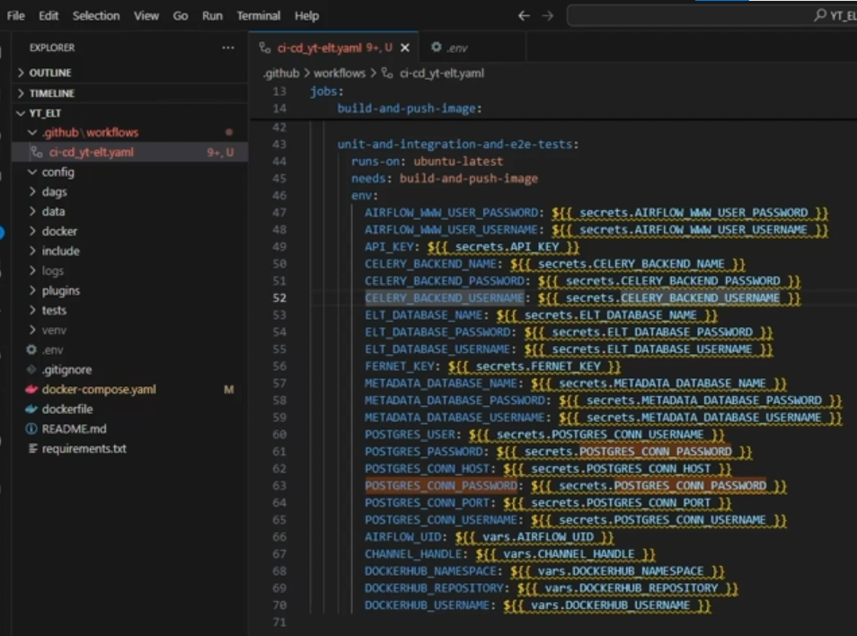
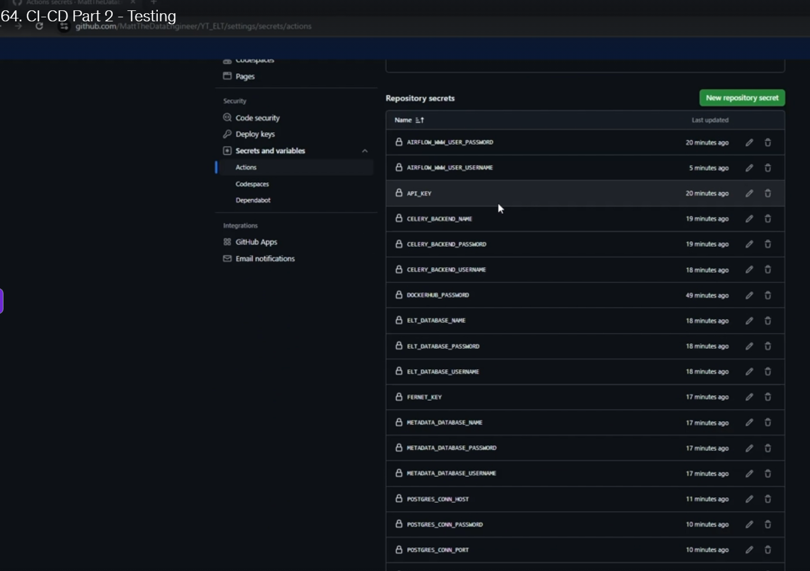
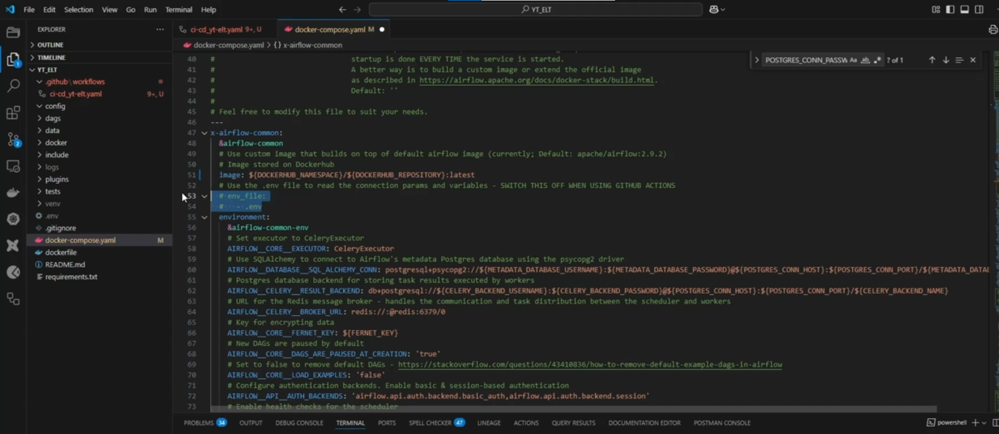
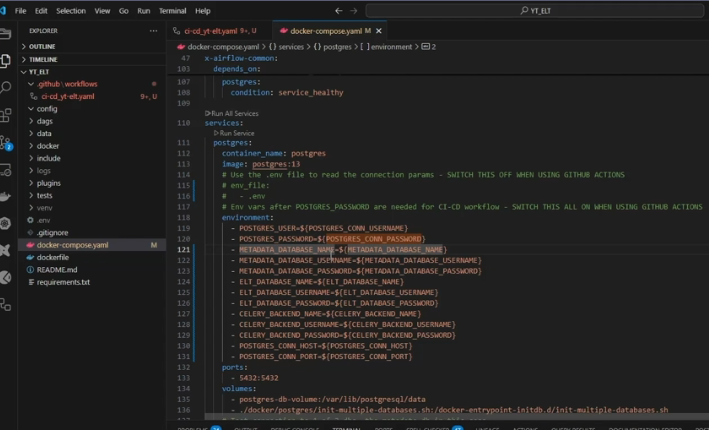
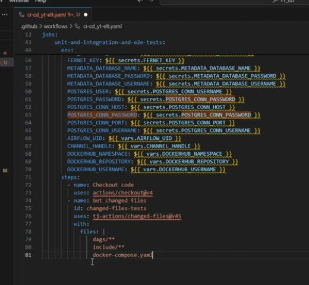
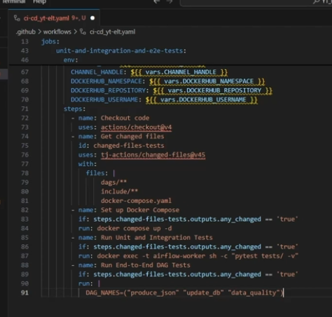
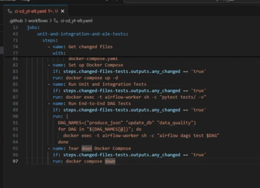
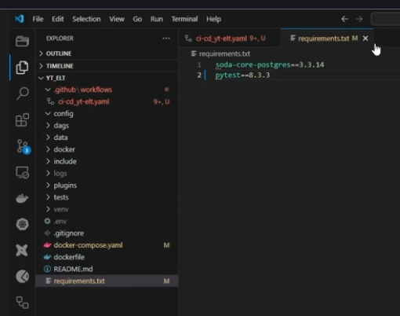

# CI/CD Part 2 — Testing the YouTube ELT pipeline

[Udemy lecture 52043917](https://www.udemy.com/course/start-your-data-engineering-journey-project-based-learning/learn/lecture/52043917#notes) · [Workflow YAML](../../.github/workflows/ci-cd_yt-elt.yaml) · [Docker Compose](../../docker-compose.yaml)

The first job decides whether the Airflow image needs rebuilding. The second starts a fresh copy of the stack, runs the Python tests, and exercises the pipeline from YouTube through PostgreSQL and Soda. GitHub runs both jobs on temporary Ubuntu runners.

## 1. Make the test job depend on the build job

In the screenshot, `needs: build-and-push-image` makes the test job wait for the build job to succeed. A job can succeed even if some of its steps were skipped. That lets a DAG-only change reach the test job without publishing a Docker image. If a required build fails, GitHub skips the test job. [GitHub job dependencies](https://docs.github.com/en/actions/reference/workflows-and-actions/workflow-syntax#jobsjob_idneeds)

The build job tags a new image with both `latest` and the Git commit SHA. The test job sets `IMAGE_TAG=latest`, so Compose pulls the current published image. A DAG-only change uses the image already on Docker Hub. A matching feature-branch push or same-repository pull request can also publish `latest`, as in the lecture.

## 2. Pass the settings from GitHub to Docker Compose

The screenshot shows **Settings → Secrets and variables → Actions**. Create each name in the table below under the corresponding repository tab. `${{ secrets.NAME }}` and `${{ vars.NAME }}` resolve GitHub settings, and the job's `env` makes them available to Compose. [Repository secrets](https://docs.github.com/en/actions/how-tos/write-workflows/choose-what-workflows-do/use-secrets#creating-secrets-for-a-repository) · [Repository variables](https://docs.github.com/en/actions/how-tos/write-workflows/choose-what-workflows-do/use-variables)

| Repository secret | Value to enter |
| --- | --- |
| `AIRFLOW_WWW_USER_PASSWORD` | Password for the CI Airflow web user. |
| `AIRFLOW_WWW_USER_USERNAME` | `airflow` |
| `API_KEY` | Your YouTube Data API v3 key. It must work from a GitHub-hosted runner. |
| `CELERY_BACKEND_NAME` | `celery_results_db` |
| `CELERY_BACKEND_PASSWORD` | Password for the CI Celery results account. |
| `CELERY_BACKEND_USERNAME` | `celery_user` |
| `DOCKERHUB_PASSWORD` | Docker Hub personal access token with repository Read & Write access. |
| `ELT_DATABASE_NAME` | `elt_db` |
| `ELT_DATABASE_PASSWORD` | Password for the CI warehouse account. |
| `ELT_DATABASE_USERNAME` | `yt_api_user` |
| `FERNET_KEY` | A valid Fernet key, such as the one in your local `.env` or a separate CI key. |
| `METADATA_DATABASE_NAME` | `airflow_metadata_db` |
| `METADATA_DATABASE_PASSWORD` | Password for the CI Airflow metadata account. |
| `METADATA_DATABASE_USERNAME` | `airflow_meta_user` |
| `POSTGRES_CONN_HOST` | `postgres` |
| `POSTGRES_CONN_PASSWORD` | Password for the CI Postgres bootstrap account. |
| `POSTGRES_CONN_PORT` | `5432` |
| `POSTGRES_CONN_USERNAME` | `postgres` |

The CI databases are created fresh, so you can choose separate passwords for CI. Use a long random string of letters and digits for the three database role passwords. Compose inserts those passwords into PostgreSQL URLs, where characters such as `@`, `:`, and `/` have special meanings. To generate a Fernet key locally with Python, run `python -c "import base64, secrets; print(base64.urlsafe_b64encode(secrets.token_bytes(32)).decode())"` and paste the output into the secret. [Docker Hub token permissions](https://docs.docker.com/security/access-tokens/reference/) · [Enable the YouTube Data API](https://developers.google.com/youtube/v3/getting-started)

| Repository variable | Value to enter |
| --- | --- |
| `AIRFLOW_UID` | `50000` |
| `CHANNEL_HANDLE` | `MrBeast`, or the YouTube handle you want to test |
| `DOCKERHUB_NAMESPACE` | `mohammadashraf97` |
| `DOCKERHUB_REPOSITORY` | `yt_api_elt` |
| `DOCKERHUB_USERNAME` | `mohammadashraf97` if you use that account's token |

The screenshot has 24 job environment lines. `POSTGRES_USER` and `POSTGRES_PASSWORD` reuse the same two Postgres secrets. The build job adds the separate `DOCKERHUB_PASSWORD` secret, for a total of 18 secrets and five variables to enter. The workflow supplies `IMAGE_TAG=latest` and the CI worker name directly. Ubuntu uses relative bind mounts, so the local Podman `CONTAINER_PROJECT_ROOT` belongs in the local `.env`.

The two Compose screenshots show the Airflow and PostgreSQL sides of the same handoff. Airflow gets its database connection URLs and exposes the YouTube settings as `AIRFLOW_VAR_API_KEY` and `AIRFLOW_VAR_CHANNEL_HANDLE`. Postgres gets the three sets of database credentials so the initialization script can create the metadata, Celery results, and ELT databases. This repo already declares those values explicitly under `environment:`. Compose reads `.env` for interpolation on your PC and the job environment on GitHub. [Compose interpolation](https://docs.docker.com/compose/how-tos/environment-variables/variable-interpolation/) · [Postgres initialization script](../../docker/postgres/init-multiple-databases.sh)

## 3. Decide which changes need testing

Each job checks out the repository and runs the changed-files action with its own list of paths. The `any_changed` output is `'true'` when a matching file changed. The build job checks `steps.changed-files-build.outputs.any_changed`, and the test job checks `steps.changed-files-tests.outputs.any_changed`.

| Change or event | What runs |
| --- | --- |
| `Dockerfile` or `requirements.txt` | Build and push the image. |
| `dags/**`, `include/**`, or `docker-compose.yaml` | Start Compose and run the tests. |
| A change in each job's list | Build and push the image, then run the tests. |
| Markdown guide or other unrelated change | Check the paths and skip the build and test steps. |
| Manual run | Start the workflow and evaluate the same file filters. |
| Fork pull request or Dependabot event | Skip the jobs that need repository credentials. |

The lecture first [adds checkout](images/ci-cd-testing/05-checkout.png), then [copies the build filter as a draft](images/ci-cd-testing/06-test-file-filter-draft.png). The finished filter below selects `dags/**`, `include/**`, and `docker-compose.yaml`. The implementation uses these same paths and pins the changed-files action to the patched v46.0.1 commit. `needs` controls ordering, while `any_changed` controls whether the relevant steps run. [GitHub events and fork behavior](https://docs.github.com/en/actions/reference/workflows-and-actions/events-that-trigger-workflows) · [Changed-files advisory](https://github.com/advisories/GHSA-mrrh-fwg8-r2c3)

## 4. Start the stack, test it, and clean up

1. `docker compose up -d --wait --wait-timeout 300` starts the stack in the background and waits for its services to be ready. Postgres initializes the databases, and `airflow-init` migrates the metadata database before the worker starts. The runner gives `AIRFLOW_UID` ownership of `data/` so the worker can write the extraction file. [Compose startup order](https://docs.docker.com/compose/how-tos/startup-order/) · [Compose up options](https://docs.docker.com/reference/cli/docker/compose/up/)
2. `docker exec -t airflow-worker sh -c "pytest tests/ -v"` runs the four unit tests and two integration tests inside the worker. Compose names that container `airflow-worker` on CI so the lecture's command can find it. The unit tests cover mocked settings and DAG structure. The integration tests call YouTube and run `SELECT 1` on the CI warehouse.
3. The workflow registers DAG metadata with `airflow dags reserialize` so Airflow can resolve the trigger targets in the fresh metadata database. It then runs `airflow dags test` once per DAG, in order. `produce_json` extracts video records and writes the dated JSON file. `update_db` loads staging and core. `data_quality` checks both schemas with Soda. Airflow 2.9.2 returns a failing exit status when a tested DAG run fails. [Airflow 2.9.2 DAG test command](https://raw.githubusercontent.com/apache/airflow/2.9.2/airflow/cli/commands/dag_command.py)
4. After a startup attempt, `docker compose down` removes the runner's containers and network. `always()` lets that cleanup step run after a failed test. The hosted runner discards its local volumes at the end of the job.

The current DAGs include two trigger operators added after the unit-test counts were written. The assertion now expects five tasks in `produce_json`, seven in `update_db`, and two in `data_quality`. The end-to-end step runs each DAG explicitly so the log shows the result of each stage. [DAG definitions](../../dags/main.py) · [Unit tests](../../tests/unit_test.py)

## 5. Run and verify the workflow on GitHub

The lecture changes the pytest pin to `8.3.3` to exercise the image-build path, then commits and pushes the workflow. This implementation uses the same pytest pin. [Lecture commit and push screenshot](images/ci-cd-testing/11-commit-and-push.png)

1. Add the 18 secrets and five variables under [Actions settings for `MohAshrafH/YT_ELT`](https://github.com/MohAshrafH/YT_ELT/settings/secrets/actions). Use the **Variables** tab for the second table.
2. Open **Actions → CI-CD Pipeline**. If the initial push ran before you entered the settings, open that run and choose **Re-run all jobs** to evaluate the original push with its build and test changes. **Run workflow** starts a manual run and uses the file filters. [GitHub manual runs](https://docs.github.com/en/actions/how-tos/manage-workflow-runs/manually-run-a-workflow) · [Re-running workflow jobs](https://docs.github.com/en/actions/how-tos/manage-workflow-runs/re-run-workflows-and-jobs)
3. Open the build job and confirm the push succeeded. On Docker Hub, `latest` and the run's full commit SHA should point to the same image. [YT_ELT image tags](https://hub.docker.com/r/mohammadashraf97/yt_api_elt/tags)
4. Open the test job. Look for `6 passed` in the pytest step, successful runs for `produce_json`, `update_db`, and `data_quality`, and a completed teardown step. Open the first failed step if the run is red. Registry login errors point to the Docker Hub username or token. A `Set ...` error in **Set up Docker Compose** names a missing repository setting. A YouTube 403 points to the API key, its restrictions, or quota. A Soda failure names the schema and check that failed.
